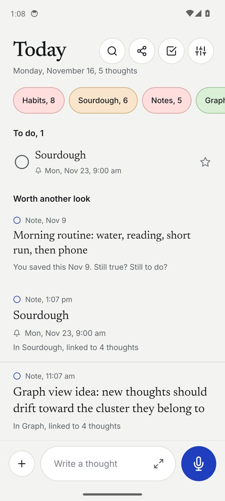
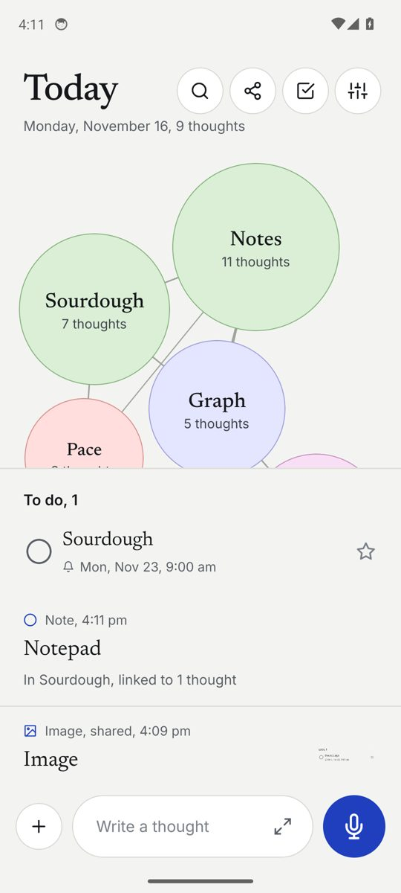
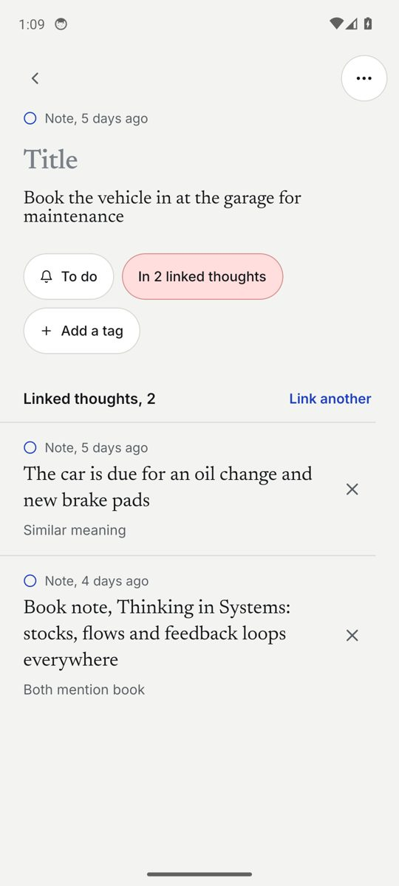

<div align="center">


### Catch the thought. Find it again. Do something with it.

A second brain for your Android phone. Everything stays on the phone, and there's no account to make.

[](../../releases)


**[Download the APK](../../releases)** &nbsp;·&nbsp; [What works today](docs/STATUS.md) &nbsp;·&nbsp; [Privacy](docs/PRIVACY.md) &nbsp;·&nbsp; [Terms](docs/TERMS.md)

<br>

<table>
  <tr>
    <td align="center"></td>
    <td align="center"></td>
    <td align="center"></td>
    <td align="center"></td>
  </tr>
  <tr>
    <td align="center"><sub><b>Today</b><br>what's due, then what's new</sub></td>
    <td align="center"><sub><b>The map</b><br>groups form by themselves</sub></td>
    <td align="center"><sub><b>A note</b><br>linked by meaning, not just words</sub></td>
    <td align="center"><sub><b>True black</b><br>easy on AMOLED screens</sub></td>
  </tr>
</table>

</div>

> [!NOTE]
> **Beta.** Engram is at version 0.x and installs from an APK, not the Play Store. Check [what works and what doesn't](docs/STATUS.md) before you rely on it.

<br>

## Why it exists

Most ideas are lost in the first minute. The thought arrives while you're reading or walking, and opening a notes app and deciding where it goes costs more attention than you have. The ones that do get written down often die a second death in a list you never scroll back through.

Engram is built around those two moments.

<table>
  <tr>
    <td width="50%" valign="top">
      <h3>Getting it in is one step</h3>
      Share from any app. Tap the widget or the Quick Settings tile. Tap the mic and talk. Type a line. There's no folder to pick and no title to think of.
    </td>
    <td width="50%" valign="top">
      <h3>It organises itself</h3>
      Each thought links to the ones it relates to, and linked thoughts gather into groups named from their own words, like "Sourdough" or "Hampi trip". A small model on your phone can also link thoughts that mean the same thing in different words, in 50+ languages.
    </td>
  </tr>
  <tr>
    <td width="50%" valign="top">
      <h3>It brings things back</h3>
      Turn any thought into a to-do. Write "call mum tomorrow 6pm" and the reminder sets itself. Each day Engram puts one older thought in front of you and asks whether it still matters.
    </td>
    <td width="50%" valign="top">
      <h3>It nudges the next step</h3>
      Open a group and gather it into one note with a line for what to do next. Or open Claude or ChatGPT with the group drafted as a request for a plan. Nothing is sent until you send it.
    </td>
  </tr>
</table>

<br>

## What you can do

| | |
|---|---|
| ✍️ **Capture** | Type, speak (transcribed on the phone), share from any app, attach photos, videos and files, scan paper, or use the widgets, the Quick Settings tile and the icon shortcuts |
| 📝 **Write** | Every entry is a note with a title and a body. Bold, headings, lists, quotes, and check boxes that count towards your to-dos |
| 🗺️ **See** | Home as a list, a map above a list, or the map alone. Play the map to watch your groups grow |
| 🔎 **Find** | Full-text search with filters. Words in your photos and screenshots are read on the phone and become searchable, in English and Hindi |
| ⏰ **Remember** | Reminders in plain words, repeats, an "important" mark, and Done or In an hour buttons on the notification |
| 📅 **Plan** | Add a thought to your calendar, or start a note from any of today's events. A focus timer for deep work |
| 🌐 **Translate** | Optionally, an English version of notes in other languages, made on the phone |
| 🔁 **Review** | A question a day, a weekly review with your streak, a monthly recap, and "on this day" |
| 🔒 **Keep** | Light and true-black themes, an app lock, a 30-day trash with undo, and backups that include your photos and recordings |

<br>

## Private by design

> Your thoughts live in a database on your phone. They are not uploaded, analysed or sold.

- **No analytics, no ads, no tracking.**
- **Voice** is turned into text by Android's offline recogniser, not a cloud service.
- **Text in pictures** is read by a recogniser built into the app, with no download and no upload.
- **Downloads happen only when you ask:** the model for linking by meaning (about 130 MB), a language pack per language for translation (about 30 MB each). After that, both run on the phone.
- **At launch** the app asks Engram's server which unfinished features are switched on. That request carries no account and none of your words.

The full details are in the **[Privacy Policy](docs/PRIVACY.md)**.

<details>
<summary><b>Engram Cloud</b>: optional sync, built but not yet switched on</summary>
<br>

When it's switched on, you can sign in under Settings and your notes, to-dos, tags and hand-made links are kept in step across your devices. If the same note is changed in two places, both versions are kept. You can sign out or delete the account and its cloud copy at any time; the phone keeps everything.

To be clear about what it is: the cloud copy is encrypted in transit and at rest, and only your account can read it through the app, but it is **not end-to-end encrypted**. Photos, videos, recordings and files are not uploaded. Details are in [docs/CLOUD.md](docs/CLOUD.md).

</details>

<br>

## Install

1. On an Android phone (Android 7 or newer, 64-bit), open **[Releases](../../releases)** and download the newest `engram-…apk`.
2. Open the file and allow the install.

> [!IMPORTANT]
> **Coming from 0.6 or earlier?** 0.7 has a new app id, so it installs beside the old app and starts empty. In the old app go to Settings, Back up. In the new one go to Settings, Restore, then uninstall the old app. Builds are signed with a development key for now, so one more reinstall will be needed when the real key arrives.

<br>

## For developers

```bash
npm ci
npx expo run:android      # a development build; Expo Go will not work
npm run typecheck && npm run lint && npm run check
```

<details>
<summary><b>The stack</b></summary>
<br>

| Concern | Choice |
|---|---|
| Framework | Expo SDK 58, React Native 0.88, Expo Router |
| Storage | PowerSync (`@powersync/react-native` on `op-sqlite`), local-only, with FTS5 search |
| Notes | `react-native-enriched-html`, a native rich text editor |
| Links and groups | Plain TypeScript: word scoring plus optional sentence vectors, then label propagation |
| Meaning | `react-native-executorch` running a multilingual sentence model on the phone |
| Text in pictures | Engram's own module (`modules/engram-ocr`) over ML Kit's bundled recognisers |
| Map | `d3-force` for layout, drawn with ordinary views |
| Reminders | `expo-notifications`, local only |
| Calendar | `expo-calendar` |
| Voice | `expo-speech-recognition`, on-device only |
| Widgets | `react-native-android-widget` |
| Cloud (optional) | Supabase: Postgres with row level security, Auth, one Edge Function |

</details>

Start with **[AGENTS.md](AGENTS.md)**, the guide for anyone, human or AI, changing this code. The spec, design rules, decisions and status are in [`docs/`](docs/), and how builds work is in [docs/CI.md](docs/CI.md).

## License

Engram's source is published so you can see how it works, but it is **not open source**. You're welcome to install the app from [Releases](../../releases), use it and report issues. Copying, modifying or redistributing the code needs written permission. See [LICENSE](LICENSE).

<br>

<div align="center">
<sub>Made for the thoughts that arrive at the wrong moment.</sub>
</div>
