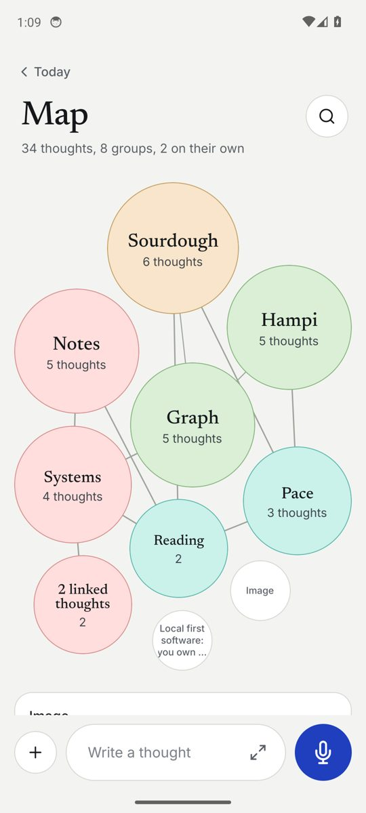
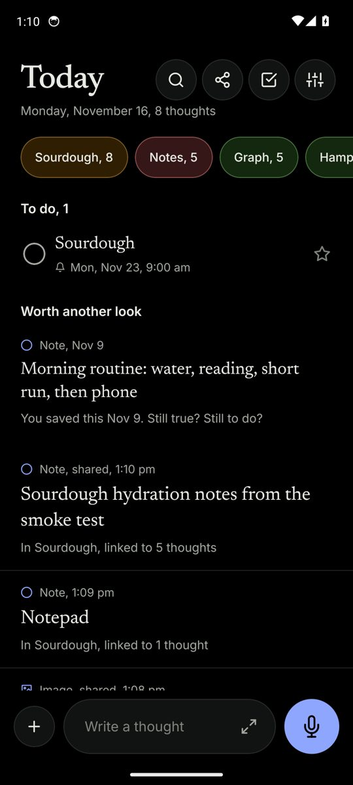

# Catch the thought. Find it again. Do something with it.

Engram is a second brain for your phone. You put a thought in within a couple of seconds, from wherever you are, and it files itself: related thoughts link up and gather into named groups without you sorting anything. Later it helps you come back to them, with reminders, a to-do list, and a button that turns a group of half-ideas into a plan.

Everything stays on your phone. There is no account and no server.

<p>
  
  
  
  
</p>

> **Beta.** Engram is at version 0.x and installs from an APK, not the Play Store. See [what works and what does not](docs/STATUS.md) before relying on it.

## Why it exists

Most ideas are lost in the first minute. You are reading something, or walking, or halfway through another task; the thought arrives, opening a notes app and deciding where it goes costs more attention than you have, and it is gone.

The ones that do get written down mostly die a second death: a list you never scroll back through.

Engram is built around those two moments.

**Getting it in takes one step, not five.**
Share to Engram from any app. Tap the home-screen widget. Tap the mic and talk. Type a line in the bar. Paste what you just copied. There is no folder to pick and no title to think of.

**It organises itself.**
Each new thought is compared with the others and linked to the ones it relates to. Linked thoughts form groups that are named from their own words ("Sourdough", "Hampi trip"). Optionally, a small language model on your phone links thoughts that mean the same thing even when they share no words, in 50+ languages.

**It brings things back.**
Any thought can go on your to-do list, with a reminder that can repeat. Today shows what is due. Each day Engram also puts one older thought in front of you and asks whether it still matters.

**It pushes you toward the next step.**
Open a group and Engram can gather it into one note with a line for the next step. If Claude or ChatGPT is on your phone, one tap opens it with the group's thoughts drafted as a message asking for a plan. You choose whether to send it.

## What you can do

| | |
|---|---|
| **Capture** | Type, speak (transcribed on the phone), share from any app, attach photos, videos and files, save your clipboard, or use the home-screen widgets |
| **Write** | Every entry is a note with a title and a body. The body takes bold, headings, lists, check boxes and quotes |
| **See** | Home as a list, as a map above a list, or as the map alone. The map shows each group as a circle and each ungrouped thought as a small one on its own |
| **Find** | Full-text search with filters by kind |
| **Remember** | To-dos with reminders, repeats, an "important" mark, and Done or In an hour buttons on the notification |
| **Plan** | Add a thought to your calendar. Optionally show your calendar's events and start a note for any of them |
| **Keep** | Light and true-black themes. Export and import a backup file |

## Private by design

- Your thoughts are stored in a database on the phone and are never uploaded.
- Speech is turned into text by Android's offline recogniser, not a cloud service.
- The app makes one download, and only if you ask for it: the language model for linking by meaning (about 130 MB).
- "Chat with Claude" and "Chat with ChatGPT" open that app with a draft. Nothing is sent until you send it there.
- The database is built on [PowerSync](https://www.powersync.com/) in local-only mode, so syncing to your own backend (Supabase, for example) can be added later without changing where your data lives today.

## Install

1. On an Android phone (Android 7 or newer, 64-bit), open [Releases](../../releases) and download the newest `engram-…apk`.
2. Open the file and allow the install.

New versions install over old ones and keep your thoughts.

## For developers

```bash
npm ci
npx expo run:android      # a development build; Expo Go will not work
npm run typecheck && npm run lint && npm run check
```

| Concern | Choice |
|---|---|
| Framework | Expo SDK 58, React Native 0.88, Expo Router |
| Storage | PowerSync (`@powersync/react-native` on `op-sqlite`), local-only, with FTS5 search |
| Notes | `react-native-enriched-html`, a native rich text editor |
| Links and groups | Plain TypeScript: word scoring plus optional sentence vectors, then label propagation |
| Meaning | `react-native-executorch` running a multilingual sentence model on the phone |
| Map | `d3-force` for layout, drawn with ordinary views |
| Reminders | `expo-notifications`, local only |
| Calendar | `expo-calendar` |
| Voice | `expo-speech-recognition`, on-device only |
| Widgets | `react-native-android-widget` |

Start with [AGENTS.md](AGENTS.md): it is the guide for anyone, human or AI, changing this code. The product spec, design rules, decisions and current status are in [`docs/`](docs/). How the builds work, and how to run them on your own machine to make them faster, is in [docs/CI.md](docs/CI.md).
